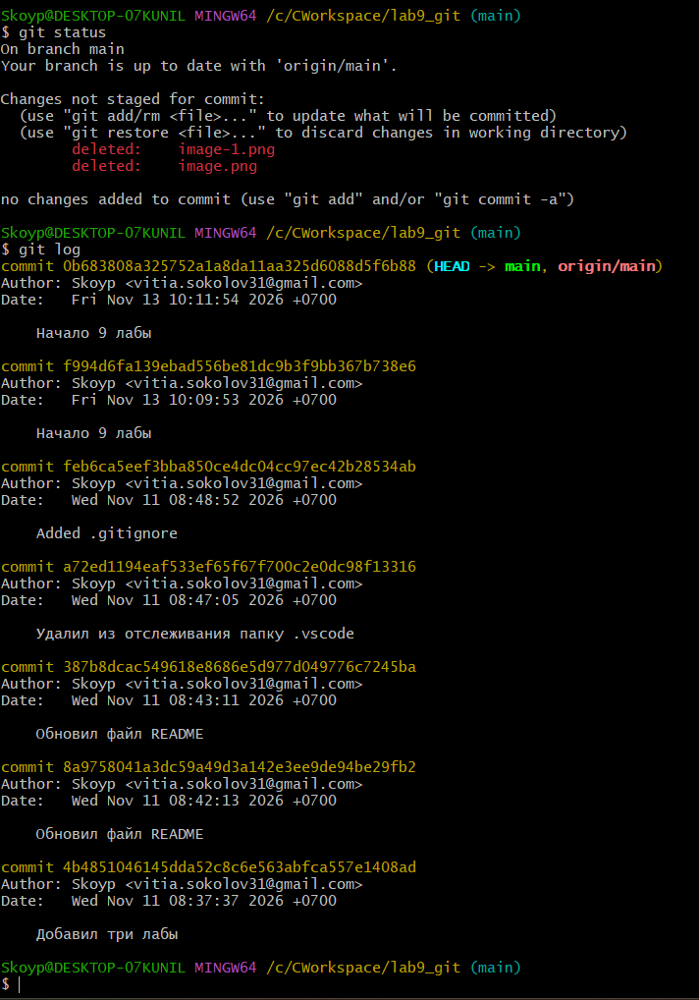
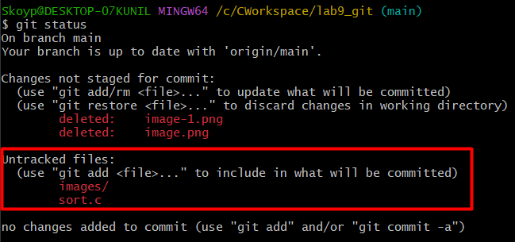
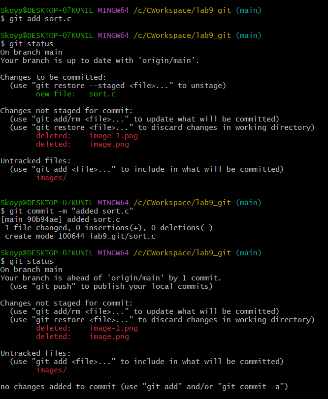

**1.** *Из команды `git status` можно увидеть, что мы находимся в ветке `main`, а `git log` показывает историю коммитов.*

---

**2.** *Файл `sort.c` станет Untracked.*

---

**3.** *Добавили файл в индекс через `git add` и коммитим командой `git commit -m "описание коммита"`.*
