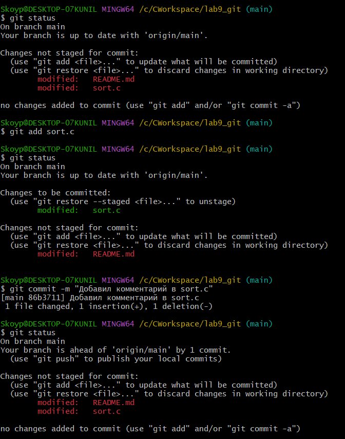
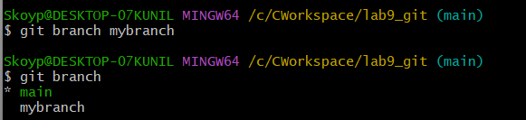
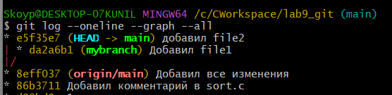

# На оценку 3

**1-2.** *Из команды `git status` можно увидеть, что мы находимся в ветке `main`, а `git log` показывает историю коммитов.*

---

**3-4.** *Файл `sort.c` станет Untracked.*

---

**5-8.** *Добавили файл в индекс через `git add` и коммитим командой `git commit -m "описание коммита"`.*

**9-17.** *После изменений файл станет modified, после того как я изменил его еще раз и закоммитил, новые изменения не попали в коммит так как я не добавил их в индекс.*

---

## Ветки

**1-5.** *`git status` покажет что мы находимся на другой ветке .*

---

**5-17.** *Видим как ветка mybranch отсоединилась от основной ветки main.
после переключения на main, file2.txt пропадает так как он находится в другой ветке*

# На оценку 4

---

**9-17.** *.*

---

**9-17.** *.*

---